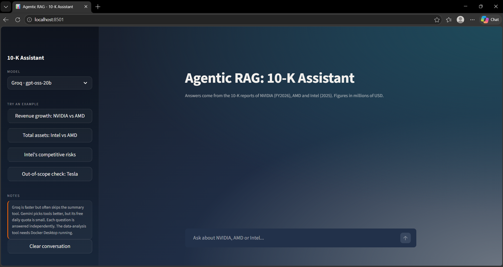

# Agentic RAG: 10-K Assistant

An agentic RAG system that answers complex questions about the annual reports (10-K) of **NVIDIA** (fiscal 2026, ended Jan 25, 2026), **AMD** and **Intel** (fiscal 2025, ended Dec 27, 2025). The agent decides when to search, refines its queries, compares companies, calculates, and cites the PDF page of every figure.

<!-- Add 1-2 screenshots of the Streamlit app here -->


## What it does

- **Knowledge base pipeline:** PDF text extraction (PyMuPDF, row-by-row rebuild so tables keep line items next to their numbers), cleaning, chunking, embeddings, storage.
- **Hybrid retrieval:** dense search (`BAAI/bge-small-en-v1.5` in ChromaDB) + BM25, fused with Reciprocal Rank Fusion, with an optional company filter.
- **Agent (LangChain `create_agent`)** with four tools:
  - `search_knowledge_base`: hybrid search, returns passages tagged `[COMPANY 10-K | PDF page N]`
  - `calculator`: safe arithmetic expressions
  - `summarize_topic`: cited bullet summaries for descriptive questions
  - `analyze_data`: the model writes pandas code, executed inside a locked-down Docker container
- **Streamlit UI** with model selection and a panel showing every tool call.
- Supports Groq (`openai/gpt-oss-20b`) and Gemini (`gemini-3.5-flash`, `gemini-3.5-flash-lite`).

## Architecture

```
10-K PDFs -> extract2.py -> chunk.py -> index.py -> ChromaDB + BM25
                                                        |
Streamlit (app.py) -> agent.py -> tools.py -> retriever.py
                          |            |
                     Groq / Gemini     +-> analyze_data -> Docker sandbox
```

Chunks are about 1,500 characters, split on line boundaries with a 2-line overlap. Every chunk starts with a header line (`[NVIDIA 10-K | PDF page 53]`), and table chunks that lose their date header get the last period header from earlier on the page.

## Setup

Developed and tested on Python 3.14 and Windows. Other setups are untested.

1. Install dependencies: `pip install -r requirements.txt`
2. Download the latest 10-K of each company from [SEC EDGAR](https://www.sec.gov/edgar/search), open the HTML filing, print to PDF, and save as `data/nvidia_10k.pdf`, `data/amd_10k.pdf`, `data/intel_10k.pdf`. Use the original 10-K, not the 10-K/A amendment.
3. Create a `.env` file:
   ```
   GOOGLE_API_KEY=your_key
   GROQ_API_KEY=your_key
   ```
4. Build the knowledge base:
   ```
   python extract2.py
   python chunk.py
   python index.py
   ```
5. Build the sandbox image (needs Docker Desktop running): `docker build -t rag-sandbox ./sandbox`
6. Run the app: `python -m streamlit run app.py`

## Example questions

- Compare NVIDIA's and AMD's revenue growth in their latest fiscal year. Which grew faster, and by how much?
- Build a table of total assets and goodwill at the end of 2025 for NVIDIA, AMD and Intel, and compute each company's goodwill as a percentage of its total assets. Use analyze_data.
- What does AMD say about its partnership with OpenAI, and what was AMD's Data Center segment net revenue in 2025?
- What was Tesla's revenue in 2025? (not in the knowledge base; the agent should say so)

## Evaluation (small, informal)

All questions have answers I checked against the PDF pages. Scoring only checks that the expected number appears, not whether the citation is right.

**Retrieval, 20 questions, hit@5** (the correct figure is in the top 5 chunks):

| Method | Score |
|---|---|
| Dense only | 17/20 |
| BM25 + company filter | 14/20 |
| Hybrid (RRF) + company filter | 18/20 |

I tuned the query handling after seeing results on the first 10 questions. On the 10 questions not seen during tuning, dense and hybrid tied at 8/10, so the hybrid advantage is within noise. I kept it because the two methods fail on different questions.

**Agent (`openai/gpt-oss-20b`):** 15/15 on single-figure questions (10 of them used while debugging) and 7/7 on multi-step questions on manual review (the automatic check gave 6/7 because its keyword list missed the wording of a correct refusal).

## Known limitations

- Most test questions are numeric. Descriptive answers (summaries) were only spot-checked, and one summary bullet I looked at was probably a distortion of the source.
- `gpt-oss-20b` skipped the summarization tool in 3 of 3 descriptive questions, and before prompt changes it mixed up current and prior-year columns. Gemini chose the right tools in 3 of 3 and read the right columns, but each model was run once.
- Free-tier limits are tight: Gemini allowed 20 requests per day per model in my runs, and Groq limited `gpt-oss-20b` to 8,000 tokens per minute, so answers can take 20-60+ seconds.
- Long tables can be split across chunks. The period-header fix helps but is not a guarantee.
- No conversation memory: each question is answered independently.
- The Docker sandbox (no network, read-only filesystem, 256 MB memory, 0.5 CPU, no capabilities, 30 s timeout) is not a perfect security boundary. This project is meant for local use, not public deployment.
- PDF page numbers in citations are the PDF's own numbering, not the page numbers printed on the filings.

## Project structure

```
app.py          Streamlit UI
agent.py        agent, system prompt, model selection
tools.py        the four tools
retriever.py    hybrid retrieval
extract2.py     PDF extraction and cleaning
chunk.py        chunking
index.py        embeddings, ChromaDB and BM25 index
eval2.py        retrieval evaluation
eval_agent.py   agent evaluation
sandbox/        Dockerfile for the analysis sandbox
```

## Author

Ramez, [github.com/rAmeZ-m](https://github.com/rAmeZ-m)